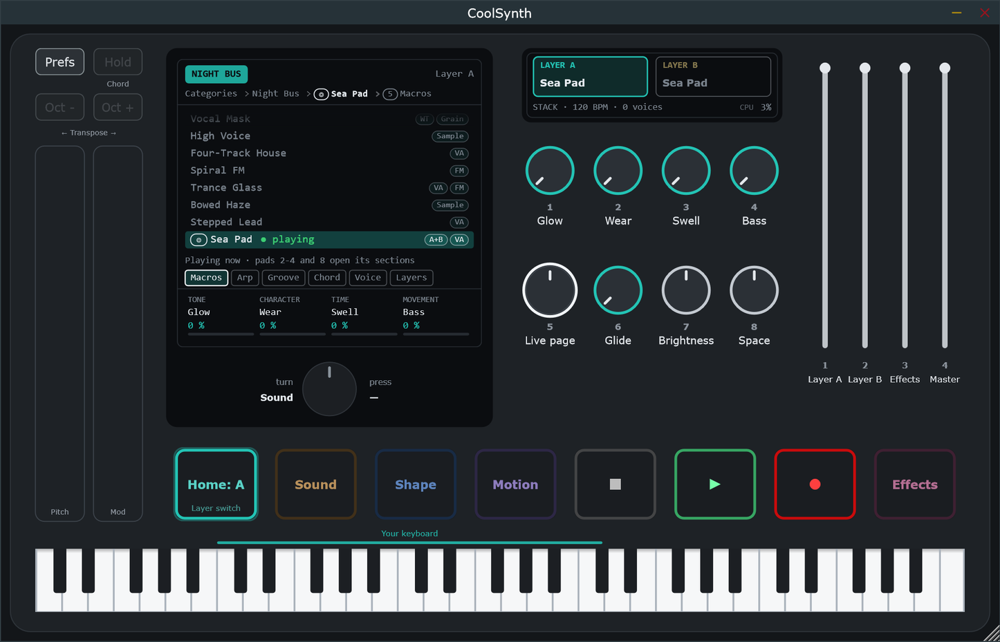

# CoolSynth



CoolSynth is a synthesizer for Windows. It runs as a standalone app or as a VST3 plugin in your DAW.

It was designed around the Arturia MiniLab 3 and uses its screen, pads and knobs, but any MIDI keyboard works.

## Download

Get the latest `CoolSynth-Setup` installer from the [Releases page](https://github.com/tomcoolpxl/CoolSynth/releases).

Windows may warn that the publisher is unknown, because the installer isn't code-signed. Click **More info**, then **Run anyway**.

The installer puts the VST3 in `C:\Program Files\Common Files\VST3` and the app in the Start menu. It also downloads the sampled instruments you select from the [instrument library](https://huggingface.co/datasets/tomccargo/coolsynth-instruments), 2.6 GB for all of them.

CoolSynth needs 64-bit Windows 10 or 11.

## Sounds

There are 136 presets in 14 rooms: synthwave, techno, ambient, lo-fi, classic synths rebuilt in the Museum, and 40 sampled acoustic instruments in the Conservatory.

CoolSynth is **bi-timbral**. A preset can use layer A and layer B, stacked on every key, split across the keyboard, or switched by velocity. Right-click a layer on the screen to copy, swap or double it.

What the engine has:

<table>
<tr><td rowspan="8">Sound sources</td><td>Virtual analog</td></tr>
<tr><td>Noise</td></tr>
<tr><td>2- and 4-operator FM</td></tr>
<tr><td>Wavetables</td></tr>
<tr><td>Plucked string</td></tr>
<tr><td>Struck bars and bells</td></tr>
<tr><td>Samples</td></tr>
<tr><td>Granular</td></tr>
<tr><td rowspan="6">Filters and shapers</td><td>Ladder and state-variable filters</td></tr>
<tr><td>Bit crusher</td></tr>
<tr><td>Wavefolder</td></tr>
<tr><td>Drive</td></tr>
<tr><td>Vowel filter</td></tr>
<tr><td>Comb filter</td></tr>
<tr><td rowspan="4">Modulation</td><td>Envelopes and LFOs</td></tr>
<tr><td>16-step modulator</td></tr>
<tr><td>24-slot modulation matrix</td></tr>
<tr><td>Four macros per sound</td></tr>
<tr><td rowspan="2">Arpeggiator and chords</td><td>Euclidean rhythms, ratchets and chance</td></tr>
<tr><td>Chord memory</td></tr>
<tr><td rowspan="5">Effects</td><td>Drive, lo-fi, phaser, flanger and chorus</td></tr>
<tr><td>Tape and ping-pong delay</td></tr>
<tr><td>Plate reverb with shimmer, and a room</td></tr>
<tr><td>Compressor, EQ and pump</td></tr>
<tr><td>Granular and pitch shifter</td></tr>
</table>

## Your own samples

Put WAV files in `C:\ProgramData\CoolSynth\Library\User`. In the Sound section, set a slot to Sample and turn its first knob past the built-in instruments to find your files. Press the knob to load one.

A sample can be sliced across the keys, in equal pieces or at its hits, on the slot's fourth page. A folder loads as a kit with one file per key.

## Controllers

Any MIDI keyboard plays CoolSynth, and its knobs, faders and pads can control the panel.

These set themselves up when you plug them in: Akai MPK mini mk3, Novation Launchkey Mini MK3 and MK4, Arturia KeyLab Essential mk3, Native Instruments Komplete Kontrol M32 and A-series.

For anything else, open **Prefs > Controller setup > Set up step by step**, or right-click a knob, fader or pad and choose **Learn**.

The setup is saved for the whole computer, so the app and every plugin instance share it.

In FL Studio, knobs only reach a plugin when both use the same MIDI port. In **Options > MIDI settings**, give your keyboard a port number. Then in CoolSynth's plugin window, open the wrapper's **Settings** tab and set **MIDI > Input port** to the same number.

## Arturia MiniLab 3

CoolSynth takes over the MiniLab's screen, pads and knobs, both in the app and in a DAW. The screen shows the sound and the knob you're turning, and the pads open the sections.

With CoolSynth on several tracks, the window you opened last gets the MiniLab. Using it inside a DAW needs Windows 11 24H2 or later.

The installer adds scripts so the pads don't also play notes in your DAW. FL Studio finds its script by itself. In Ableton Live, open **Settings > Link, Tempo & MIDI** and choose CoolSynth_MiniLab as a control surface, with input Minilab3 MIDI and output None.

To use the MiniLab as an ordinary MIDI controller instead, turn off **Prefs > Controller setup > MiniLab 3 driver**.

## Building from source

You need Windows, Git, CMake 3.22 or newer, and Visual Studio 2022 or its Build Tools.

```powershell
git clone --recurse-submodules https://github.com/tomcoolpxl/CoolSynth.git
cd CoolSynth
cmake --preset vs2022-debug
cmake --build --preset build-debug --config Debug
ctest --test-dir build -C Debug --output-on-failure
```

Debug builds are optimized, so they play in real time. Use `--config Release` for a build you want to give to someone else. Add `-DCOOLSYNTH_ENABLE_VST3_USER_INSTALL=ON` to copy the VST3 into your user VST3 folder after every build.

How the engine works is described in [docs/architecture.md](docs/architecture.md).

## License

CoolSynth's own code is MIT licensed (see `LICENSE`). It's built with [JUCE](https://juce.com) 8 under the free [Starter licence](https://juce.com/legal/juce-8-licence/). The sampled instruments come from Versilian Studios' VSCO 2 Community Edition and the Versilian Community Sample Library, both CC0.
