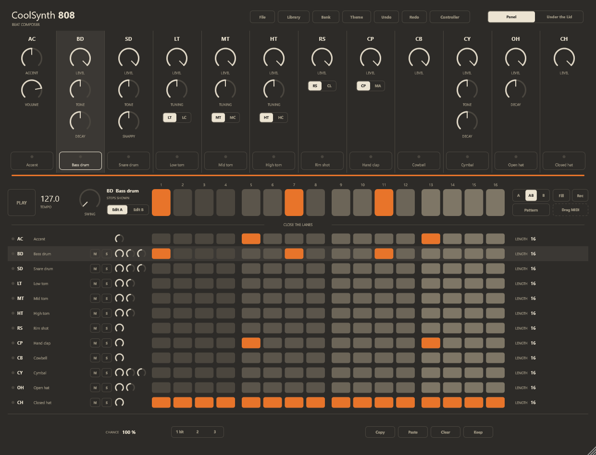
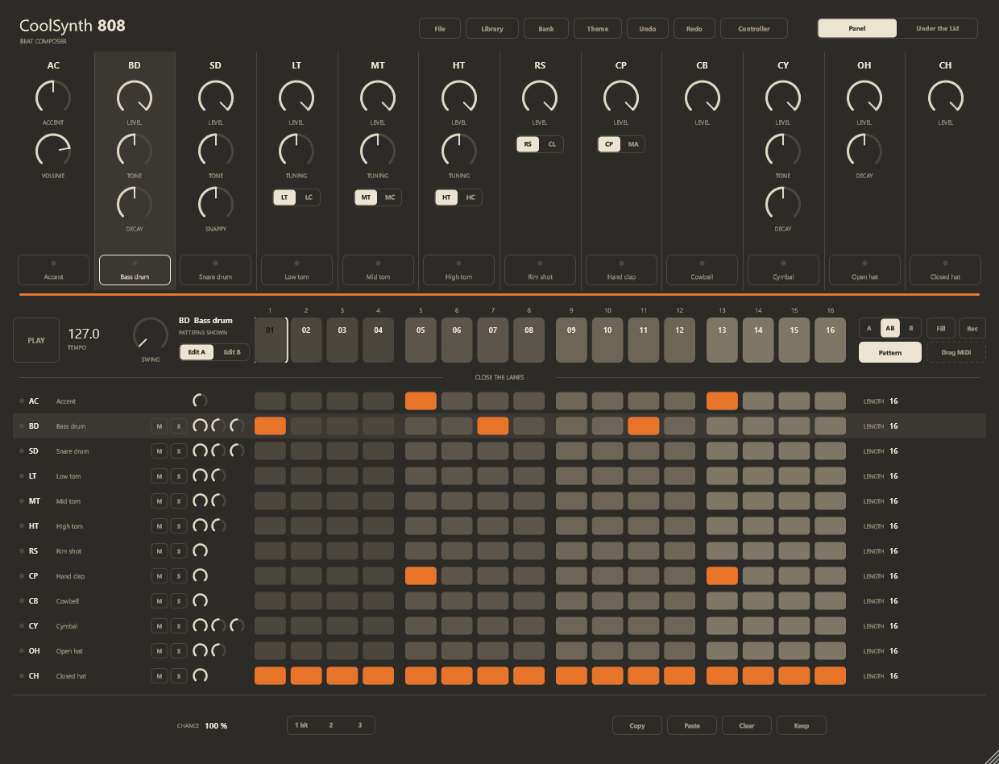
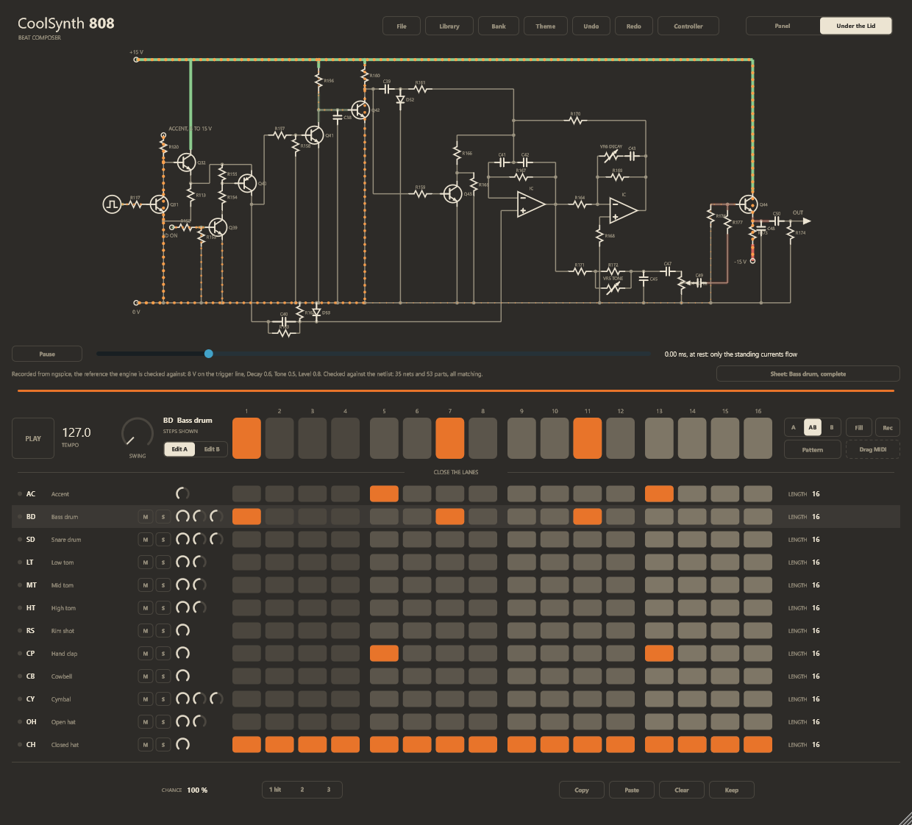

# CoolSynth 808: UX and UI review

A review of the app as it stands at CoolSynth808 `d5e4d76` (2026-11-23), asked for by the user. The UX comes first:
what a person can do, how they find it and what confuses them. The UI follows: how it looks.
It follows the design critique framework (first impression, usability, hierarchy, consistency, accessibility) and
weighs every finding against good examples found online, named with their sources at the end.

The user's frame for it:

- For producers and curious learners alike, both drawn in by the live circuit.
  - A simple and an advanced view feel lame; the two have to be served another way.
- Used standalone first, later as a plugin in a DAW.
  - The app needs a clear way to jam with patterns and chains and a light song mode; long arrangements belong to the DAW.
- The 808's spirit with a modern workflow.
  - Kept: the sixteen steps, A and B, the colour bands, the knobs per drum. Everything else is free: views, tabs,
    a song row, extra screens.
- What the user already said:
  - Programming one pattern is very easy, and A, then B, then AB is fantastic.
  - With more tracks, patterns and chains it is not clear.
  - Under the Lid is the selling point, real data and dynamically calculated, but "I don't know where to go, it
    feels off". Linking knobs to circuit parts is not wanted. A full-screen circuit as a screensaver is a welcome extra.
  - The colours are reasonable. The graphics look like UI, and the font does not fit.

## UX review

The app as reviewed: the panel with the lanes open, the step keys as pattern keys, and Under the Lid on the bass
drum's complete sheet.

### First impression

The eye goes first to the twelve columns of knobs across the top, then to the big orange steps.
That is a sound designer's first impression, not a beat maker's: the knobs are what you touch least while making a
beat, and they take the best third of the window.

The purpose is clear within seconds: a drum machine with sixteen steps.
The selling point is not: Under the Lid is a small toggle in the top right corner, the same weight as Theme and Undo.
Nothing on the first screen hints that there is a live circuit inside.

### Making one pattern

This works, and it is the strongest part of the app.

- Click a step and it sounds; the steps are big, in four colour groups, and the lanes show every drum at once.
- A, AB and B are one click each, and Edit A and Edit B say which half you are writing.
- Chance by dragging a step down is quick and visible in the step's height.

What gets in the way:

- The step row and the lanes show the same thing twice.
  - With the lanes open, the big row repeats the selected drum's lane right above it ("BD Bass drum, steps shown").
  - A person editing the bass drum sees its steps in two places and has to work out that they are one.
  - The big row only earns its place with the lanes closed, where it is the 808's own way of working: pick a drum,
    then set its steps.
- The knobs are shown twice too: big at the top, small on each lane, and the small ones have no labels.
- The step inspector (chance, one to three hits) sits at the bottom of the window, far from the step it changes, and
  reaches it only by a right-click that nothing on screen mentions.
- Copy, Paste, Clear and Keep stand in that same inspector line, but they act on the whole pattern, not on the step.
  "Keep" does not say that it saves to the library.
- Length per lane is a number on the far right; what it does (a shorter lane runs on across the bars) is only in the
  README.

### Patterns, banks, chains and the fill

This is where the user loses the thread, and the reasons are concrete.

- One row of sixteen keys means two things.
  - Pattern turns the step keys into pattern keys; the same row, the same colours, only a small outline and a stripe
    change.
  - A person cannot see both at once: which steps they are writing and which pattern is playing.
- Which pattern is being edited and which one plays is shown by two thin outlines (ink and lit) on the pattern
  keys, and only in pattern mode. In step mode nothing says "you are editing pattern 03 while 05 plays".
- A chain is made by clicking a key and shift-clicking another: a hidden gesture, and only a run of neighbours
  (03 to 06), never 01, 01, 04, 02.
  - The chain shows as stripes on the keys it covers: its order, its length and where it is now are not visible.
  - Nothing says what plays next or when a change will take effect (the app switches on the next bar, as it should,
    but does not show that it is waiting).
- Banks sit behind a menu at the top, away from the pattern keys they fill; a bank change gives no sign on the panel
  beyond the menu's tick.
- Fill does two different things by context: clicked while playing it queues the fill, clicked while stopped (or
  with shift) it opens the fill for editing. The same button, two meanings, and the second one hidden.
- A and B are halves of a pattern, the patterns are sixteen a bank, the chain is a run of patterns, the fill is one
  a bank: four ideas of "a part of the beat" with four different controls in four places.

What the research says works (see the sequencer examples at the end) is folded into the directions below.

### Under the Lid

The view itself is impressive: a real circuit, lit by real currents. What feels off is where it lives.

- It replaces the knobs at the top of the window and grows the window by about 170 pixels, so the layout jumps when
  it opens.
- The whole board and the ten complete sheets are one button apart ("Sheet: Whole board" in the bottom right), but
  the jump is a cut: nothing on the board says that a drum's block opens into its sheet, and nothing on a sheet says
  where on the board it sits.
- The board plays live with the beat; a complete sheet plays one recorded hit in slow motion on its own timeline.
  Two different clocks in one view, not explained on screen.
- It cannot be shown beside the knobs, so watching a circuit and turning its drum are two places.
- There is no way in that is not the toggle: no small live board on the panel, no hint, no full screen.

### The library

The shelf works and needs little: shelves on the left, beats with a thumbnail in the middle, the beat and its
actions on the right. Audition from the next bar is right.

- It covers the whole window, so the panel and its pattern keys are hidden while choosing.
- "Load into pattern 1" names the target, which is good; it is the only place in the app that does.
- "Keep a copy" here and "Keep" on the panel are the same idea under two names.

### Menus, feedback and the keyboard

- File, Library, Bank, Theme, Undo, Redo and Controller are seven equal buttons; how often each is used varies a hundredfold.
- Rec, Fill and Pattern change state without much sign: a filled chip, the same size as the rest.
- The keys: Space plays and stops, Ctrl with Z, Y, S and O undo, redo, save and open, and up and down choose the
  drum. Patterns, A and B, fill, mute and record have none.
- Tempo is a number to drag, with no tap.

### Producers and learners without a simple and an advanced view

The research (Nielsen Norman Group on progressive and staged disclosure) agrees with the user: a mode switch adds a
choice before anything happens and hides daily features from one group.
What works instead is depth that opens where you are:

- The main screen is for making beats, complete for a producer.
- The circuit is always present but quiet, a live strip or picture that rewards a glance, and opens into depth when
  clicked: board, then drum, then part, then what the part does.
- Learning is offered, never imposed: short tours that end in free play, as Ableton's Learning Synths does, reached
  from the circuit, not from a mode.

## UI review

### Why it reads as UI and not as an instrument

The research on what makes music software look like an instrument (Roland, D16, Ableton, Elektron, Teenage
Engineering, FabFilter, Microtonic) points to the same few things, and the app misses most of them.

- The type is Segoe UI, Windows' own system font.
  - It is what every Windows dialog uses, so the panel reads as a Windows form; on a Mac it would fall back to
    another system font and look different again.
  - It comes in fourteen sizes and two weights (from 5.6 to 27 points): headings, body text, labels, all mixed.
    Instruments label things; they have one or two sizes.
  - The 808's own labels are small Helvetica capitals in a medium weight (CDM on the 808; Fonts In Use on the 909).
- Every control sits in its own box with rounded corners and a border: the menu buttons, the drum buttons, the
  chips, the inspector. Cards with gaps between them are what make a screen look like a web dashboard; panels group
  with printed rules and bands on a tight grid.
- The knobs are value arcs, a thin ring with a pointer line, which reads as a web slider. Hardware knobs are a solid
  cap with one pointer and printed ticks around them.
- The steps are flat rounded rectangles that fill with orange when on. Hardware steps are keys with a face and an
  edge, and their state is a small light, so the four colour groups stay visible whether a step is on or off.
- The panel is evenly spaced and roomy. Hardware and the best software (Microtonic, Elektron, the 808 itself) are
  dense, with a few even gutters and rules.
- There is no depth at all. The good examples use a little: one soft light from above on keys and knobs, a thin
  edge, and a flat panel (FabFilter, Nepheton 2).

### Visual hierarchy

- The top third is twelve equal columns of knobs, the strongest area in the window for the least used controls.
- The orange rule under the knobs is the strongest line on the panel and separates nothing important.
- The seven menu buttons, the view switch, the A/AB/B, Fill, Rec, Pattern and Drag MIDI chips all have the same
  weight. Play is a grey box the size of a step.
- The lanes take most of the window and are the right thing to emphasise; their labels, mute and solo and the small
  unlabelled knobs crowd their left side.

### Consistency

- Two sizes of every knob, the big ones labelled and the small ones not.
- Chips for menus, for modes (Pattern, Rec) and for actions (Copy, Keep) look the same, though one opens a list,
  one changes the step keys' meaning and one does something at once.
- The library is designed with more care than the panel (its type sizes, its thumbnails), so the two read as
  different apps.
- Under the Lid's sheet chooser and its Pause button are a third style again.

### Accessibility

Measured on the Studio 1982 theme with WCAG's contrast formula:

- The cream labels on the panel are 11.2 to 1, fine. The dim labels are 4.6 to 1, just over AA, but at 8 to 9
  points they are hard to read anyway. On Paper (3.9) and Night (3.5) the dim labels fail AA.
- A lit step in the fourth group is 1.5 to 1 against an unlit one: orange against a mid grey of nearly the same
  brightness. The difference is carried by hue alone, which a colour-blind player can miss.
- Unlit steps in the first group are 1.5 to 1 against the panel, so the grid fades out on a dim screen.
- The mute and solo buttons are 20 by 18 pixels and the small knobs on the lanes about 16; 24 is the usual minimum
  for a target (WCAG 2.2's target size).
- Nothing has a keyboard focus that can be seen.

### What works

- The colours: the warm greys and one orange are calm and recognisably the 808's family without copying Roland.
- The four themes are complete and consistent with each other.
- The steps are large, easy to hit and grouped in fours.
- Under the Lid's drawing: thin lines, small part labels, current as dots. It looks like a real schematic, and the
  motion is what makes it.
- The library's thumbnails of each beat's steps.

## Directions

### The circuit, always there

The circuit research found no other 808, from Roland, Arturia, D16 or Audiorealism, that shows its circuit at all;
Roland's ACB says "every detail of the analog circuitry" in words only. It is a real first, and it should be on
screen whenever the app is.

- A live board on the main screen, small and quiet, lit by the beat (overview and detail side by side, in the terms of
  Cockburn, Karlson and Bederson's review). Never a page you leave the beat for.
- One drawing instead of a board and ten sheets: zoom from the whole board into a drum's block and its complete
  sheet fades in where the block was (semantic zoom, as Pad++ and Visual 6502 do), or the sheets drawn as boxes on
  the board with their trigger, accent and output wired in (KiCad's hierarchical sheets). Never a cut.
- Spicing it up: a phosphor afterglow, so a bar of the beat leaves a heat map on the board; bloom on bright wires;
  capacitors that fill and drain; a sweep along the trigger bus at each step; current dots whose speed follows the
  current, as Falstad's do.
- Listening inside: a probe dropped on a wire plays that node's recorded waveform. No other instrument does this.
- Instant replay: the last hit of any drum in slow motion, on demand.
- Full screen as the screensaver the user suggested: the whole board playing with the beat, a camera that drifts to
  the drum just struck, a few looks (blueprint, phosphor, X-ray). It doubles as stage visuals and as the trailer.

### Patterns, chains and a light song

Each of these is shown where it is used and never shares a row with the steps.

- A pattern row of its own, always visible: sixteen slots of the bank, each showing whether it holds anything, with
  the bank as tabs at its end and the fill as its own slot.
- Three states never mixed, each in its own visual channel:
  - the pattern being edited, a steady frame;
  - the one playing, lit, with a bar of progress across it;
  - the one queued, blinking until it comes in, with a word ("next: 05") so it does not rest on the blink alone.
  - Microtonic (blue for edited, flashing green for playing), Roland's 909 software (its own edit selector),
    Novation Circuit (View Lock) and the TR-8S all keep the first two apart. Elektron ties them together and its
    users complain; when they differ, a line says "editing 03, hearing 05".
- When a change comes in: at the next bar, as now, or at the end of the pattern or chain, as Arturia's DrumBrute and
  Elektron's CHANGE setting offer; a countdown shows it coming.
- The chain as a row of blocks you can read (Polyend Play, Circuit): any order, with repeats, a count on each block;
  the playing block filled with its progress, the next one outlined. It is kept until changed, never lost when a
  pattern is picked (an Elektron complaint). Hold-and-press stays as the quick way, the 808's.
- A light song: rows of patterns or chains with repeats, made from the chain in one step (Elektron's "rows from
  chain"), and recordable by playing: pattern presses and fills while running are written into it, the 808's way
  that Sound On Sound prefers over assembling offline.
  - A song row points to a pattern, so editing the pattern changes every row that uses it; this is said on screen,
    and a "make unique" copies it (the trap FL Studio's users fall into).
  - Song and patterns in one view, never a mode you get stuck in (Maschine's Ideas and Song, Elektron leaving song
    mode when a pattern is picked).
- Fill as a button that only plays the fill, armed and shown where it will land; the fill edited by selecting its
  slot on the pattern row, like any pattern. An automatic fill every 4, 8 or 16 bars, as the TR-8S and the 808 have.
- A and B stay as the 808 has them, next to the pattern row, because the user loves them, and the song stores which
  of them plays (Polyend's song not storing it is what lost its users).
- Each lane shows its own length inside the lane, its end marked on the steps, as the TR-8S's last step.

### The sound controls

- One set of knobs, for the selected drum, beside the lanes (Microtonic's way: one panel for the drum you are on).
- Or the 808's twelve columns kept, but as a view of its own (as Nepheton 2 and Roland Cloud keep the classic panel
  apart from their edit view).
- The lanes keep mute and solo and a level each, the knobs you touch while playing.

### The look

- One typeface for every label, a Helvetica-like grotesque in small capitals, two sizes, and tabular figures for
  numbers. Free candidates: Inter, Archivo (with its condensed widths), IBM Plex Sans Condensed with Plex Mono,
  Barlow, D-DIN.
- Printed rules and bands on a tight grid instead of boxes and gaps.
- Keys with a face, an edge and a small light; knobs as solid caps with a pointer and printed ticks; one soft light
  from above on both, the panel flat.
- Light only where something happens: the lights on lit steps, the playhead, the circuit.

## Three layouts to try as mockup views

Each is built as a view of its own inside the app, switchable, not wired to the sound at first, so the user can judge
them at real size. All three use the pattern row, the selected drum's knobs and the new type; they differ in what
sits at the centre.

- The beat desk: the sequencer at the centre.
  - The pattern row and the chain across the top, the lanes in the middle, the selected drum's knobs to the right.
  - The live board as a band across the top of the window, lit by the beat; a click zooms it open over the lanes.
  - Closest to a modern groovebox (Elektron, Maschine); the fastest for making beats.
- The 808 and its lid: the 808's own face.
  - The twelve columns and the step row as the classic panel, with the lanes and the pattern row in an edit view
    beside it, and Under the Lid as the third view.
  - The look of the hardware, the most recognisable; the circuit stays a page of its own, as now, but reached by
    zooming.
- The open machine: the circuit at the centre.
  - The whole board fills the top half and is the drum selector: click a drum's block and its knobs appear beside
    it; zoom in and its complete sheet opens in place.
  - The lanes and pattern row dock below.
  - The selling point first and the most original; the board must stay readable at that size and the beat must
    stay fast to make.

The full-screen circuit comes with any of them.

## Sources

Patterns, chains, songs and fills:

- Roland TR-8S reference manual, https://static.roland.com/assets/media/pdf/TR-8S_Reference_eng03_W.pdf
- Attack Magazine on the TR-909 software, https://www.attackmagazine.com/technique/tutorials/the-beginners-guide-to-the-tr-909/
- Elektron Digitakt II manual, https://www.analoguehaven.com/elektron/digitakt-ii/manual.pdf
- Elektronauts on song mode, https://www.elektronauts.com/t/introducing-song-mode-on-digitakt-syntakt-digitone-digitone-keys/180351
- Elektronauts on editing a pattern while another plays, https://www.elektronauts.com/t/step-sequencers-that-let-you-edit-a-sequence-while-another-one-is-playing/138064/24
- Polyend Play manual, https://www.manualslib.tech/guide/917828/polyend-play-manual.html
- Polyend forum on variations in song mode, https://backstage.polyend.com/t/what-is-the-relationship-of-variations-to-song-mode/9347
- Teenage Engineering EP-133 workflow, https://teenage.engineering/guides/ep-133/workflow
- Novation Circuit Rhythm patterns, https://entorwellian.neocities.org/novation/Novation/Circuit%20Rhythm/Patterns.html
- Sound On Sound on Circuit Tracks, https://www.soundonsound.com/reviews/novation-circuit-tracks
- Sound On Sound on the DrumBrute Impact, https://www.soundonsound.com/reviews/arturia-drumbrute-impact
- Sound On Sound on the Behringer RD-8, https://www.soundonsound.com/reviews/behringer-rd-8-rhythm-designer
- Ableton Live manual, launching clips, https://www.ableton.com/en/live-manual/12/launching-clips
- Maschine arranger manual, https://www.native-instruments.com/ni-tech-manuals/maschine-mk3-manual/en/working-with-the-arranger
- NI community on getting back to the scene view, https://community.native-instruments.com/discussion/6682/how-to-get-back-to-scene-view-so-i-can-change-patterns
- Microtonic manual, https://www.manualsdir.com/manuals/349731/sonic-charge-microtonic.html?page=22
- FL Studio channel rack, https://www.image-line.com/fl-studio-learning-content/fl-studio-online-manual/html/channelrack.htm
- KVR on FL Studio's make unique, https://www.kvraudio.com/forum/viewtopic.php?p=7304577

The live circuit:

- Falstad CircuitJS, https://www.falstad.com/circuit/
- EveryCircuit, https://everycircuit.com/
- Visual 6502, https://visual6502.org/JSSim/index.html
- Bret Victor, Up and Down the Ladder of Abstraction, https://worrydream.com/LadderOfAbstraction/
- Bartosz Ciechanowski, Sound, https://ciechanow.ski/sound/
- Ableton Learning Synths, https://learningsynths.ableton.com/
- Reason's rear panel, https://docs.propellerheads.se/reason9/RoutingAudioAndCV.15.5.html
- Cockburn, Karlson and Bederson, overview and detail, zooming and focus and context, https://www.microsoft.com/en-us/research/wp-content/uploads/2008/01/cockburn-ComputingSurveys09.pdf
- Pad++ semantic zoom, https://www.cs.umd.edu/projects/hcil/pad++/papers/jvlc-96-pad/zoom-3.html
- KiCad hierarchical sheets, https://docs.kicad.org/master/en/eeschema/eeschema_schematic_creation_and_editing.html
- MilkDrop, https://www.geisswerks.com/milkdrop/milkdrop.html
- Roland's TR-8 and ACB, https://www.roland.com/us/products/tr-8/

Beginners and experts:

- Nielsen Norman Group, progressive disclosure, https://www.nngroup.com/articles/progressive-disclosure/

The look:

- The TR-808, https://en.wikipedia.org/wiki/Roland_TR-808
- CDM on the 808's typefaces, https://cdm.link/2016/08/watch-futuristic-vintage-roland-808-ad-celebrate-808-day/
- Fonts In Use, the TR-909, https://fontsinuse.com/uses/53445/roland-tr-909-rhythm-composer
- Roland TR-8S features, https://www.roland.com/uk/products/tr-8s/features/
- CDM on Nepheton 2, https://cdm.link/nepheton2-808-plugin-review/
- Ableton Sans, https://lettersfromsweden.se/ableton
- Elektronauts on Elektron's graphic design, https://www.elektronauts.com/t/elektron-graphic-industrial-design/184486
- Fonts In Use, Maschine Mk3, https://fontsinuse.com/uses/43145/maschine-mk3-dinamo
- KVR on FabFilter's design, https://www.kvraudio.com/forum/viewtopic.php?p=7545507
- Microtonic, https://soniccharge.com/microtonic
- WCAG 2.2, target size, https://www.w3.org/WAI/WCAG22/Understanding/target-size-minimum.html
- Inter, https://github.com/rsms/inter ; Archivo, https://github.com/Omnibus-Type/Archivo ; IBM Plex,
  https://github.com/IBM/plex ; Barlow, https://github.com/jpt/barlow ; D-DIN, https://www.fontsquirrel.com/fonts/d-din
